<!--
  Profil de Loan Heron — même direction artistique que loan-heron.fr
  Les visuels (versions sombre et claire) sont générés par : node scripts/build-svg.mjs
-->

<a href="https://loan-heron.fr">
  <picture>
    <source media="(prefers-color-scheme: dark)" srcset="assets/hero-dark.svg" />
    
  </picture>
</a>

  

<picture>
  <source media="(prefers-color-scheme: dark)" srcset="assets/about-dark.svg" />
  
</picture>

  

<picture>
  <source media="(prefers-color-scheme: dark)" srcset="assets/h-projets-dark.svg" />
  
</picture>

<a href="https://breche.loan-heron.fr">
  <picture>
    <source media="(prefers-color-scheme: dark)" srcset="assets/projects/breche-dark.svg" />
    
  </picture>
</a>
<a href="https://halteo.loan-heron.fr">
  <picture>
    <source media="(prefers-color-scheme: dark)" srcset="assets/projects/halteo-dark.svg" />
    
  </picture>
</a>
<picture>
  <source media="(prefers-color-scheme: dark)" srcset="assets/projects/homelab-dark.svg" />
  
</picture>
<a href="https://elvo-studio.fr">
  <picture>
    <source media="(prefers-color-scheme: dark)" srcset="assets/projects/elvo-studio-dark.svg" />
    
  </picture>
</a>

  

<picture>
  <source media="(prefers-color-scheme: dark)" srcset="assets/h-ecole-dark.svg" />
  
</picture>

<a href="https://github.com/loan-heron/lenapoleon"><picture><source media="(prefers-color-scheme: dark)" srcset="assets/projects/le-napoleon-dark.svg" /></picture></a>
<a href="https://github.com/loan-heron/api"><picture><source media="(prefers-color-scheme: dark)" srcset="assets/projects/budjet-api-dark.svg" /></picture></a>
<a href="https://github.com/loan-heron/API-WatchList"><picture><source media="(prefers-color-scheme: dark)" srcset="assets/projects/watchlist-dark.svg" /></picture></a>
<a href="https://github.com/loan-heron/FrigoFlash"><picture><source media="(prefers-color-scheme: dark)" srcset="assets/projects/frigoflash-dark.svg" /></picture></a>
<a href="https://github.com/loan-heron/ArenaZone"><picture><source media="(prefers-color-scheme: dark)" srcset="assets/projects/arena-zero-dark.svg" /></picture></a>
<picture><source media="(prefers-color-scheme: dark)" srcset="assets/projects/donjon-gobelins-dark.svg" /></picture>

  

<picture>
  <source media="(prefers-color-scheme: dark)" srcset="assets/skills-dark.svg" />
  
</picture>

  

<picture>
  <source media="(prefers-color-scheme: dark)" srcset="assets/outils-dark.svg" />
  
</picture>

  

<!-- Activité GitHub : regénérée chaque jour par .github/workflows/stats.yml (données publiques) -->
<picture>
  <source media="(prefers-color-scheme: dark)" srcset="assets/stats-dark.svg" />
  
</picture>

  

<picture>
  <source media="(prefers-color-scheme: dark)" srcset="assets/parcours-dark.svg" />
  
</picture>

  

<a href="https://loan-heron.fr/#contact">
  <picture>
    <source media="(prefers-color-scheme: dark)" srcset="assets/contact-dark.svg" />
    
  </picture>
</a>

  <a href="https://loan-heron.fr">loan-heron.fr</a> &nbsp;·&nbsp;
  <a href="https://loan-heron.fr/#contact">Me contacter</a> &nbsp;·&nbsp;
  <a href="https://www.linkedin.com/in/loan-heron">LinkedIn</a> &nbsp;·&nbsp;
  <a href="https://breche.loan-heron.fr">Brèche</a> &nbsp;·&nbsp;
  <a href="https://elvo-studio.fr">Elvo Studio</a>

© 2026 Loan Heron
