<!--
  HERON·OS — profil de Loan Heron
  Les visuels du dossier assets/ sont générés par : node scripts/build-svg.mjs
  (modifie les textes / projets dans ce script, relance-le, puis pousse.)
-->

  

 


  

 


  

 


<a href="https://github.com/loan-heron/lenapoleon"></a>
<a href="https://github.com/loan-heron/api"></a><a href="https://github.com/loan-heron/API-WatchList"></a>
<a href="https://github.com/loan-heron/FrigoFlash"></a><a href="https://github.com/loan-heron/ArenaZone"></a>
<a href="https://github.com/loan-heron/memory"></a>

  <code>+ aussi</code>&nbsp; <a href="https://github.com/loan-heron/les-pattes-libres">les-pattes-libres</a> · <a href="https://github.com/loan-heron/HopJob">HopJob</a> · <a href="https://github.com/loan-heron/GestionProjetCours">GestionProjetCours</a>

 


  
  

  

 


  
  
  

 

  

